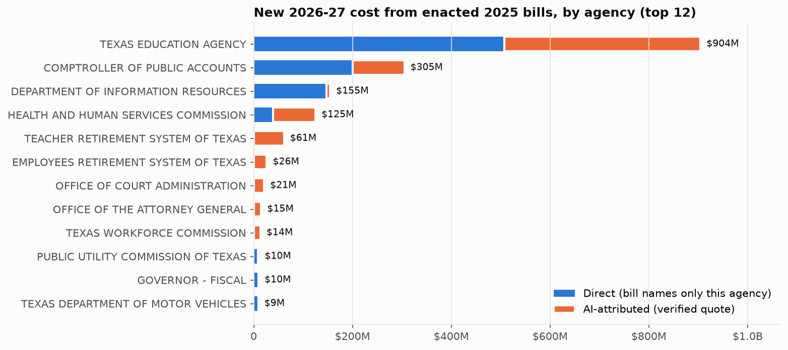
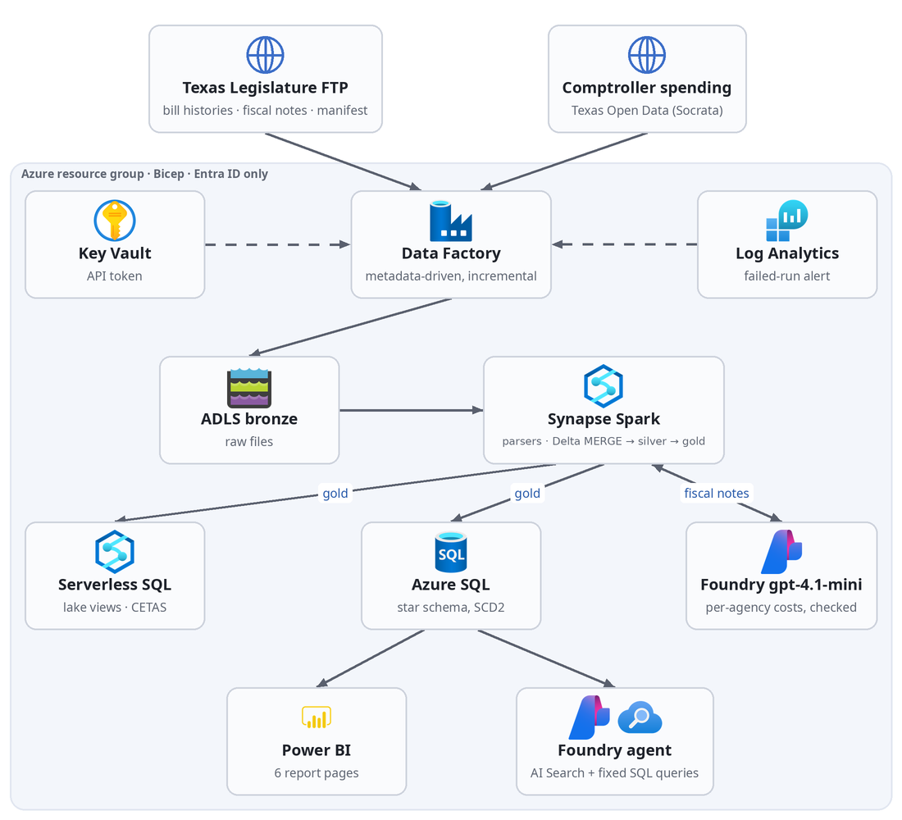
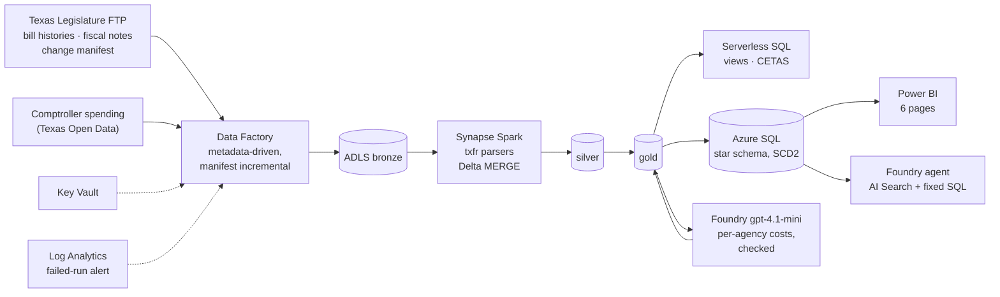

# Texas Fiscal Radar: learning how the Texas Legislature works, from its own files

**Why.** To understand the inner workings and outcomes of the Texas Legislature (how bills move, where they stall,
what the laws that pass will cost and who carries the cost) from the complete record of the 2025 session, and then to
follow the **90th Legislature, which convenes on January 12, 2027**, as it happens. Plain-language guide:
**[docs/LEGISLATURE.md](docs/LEGISLATURE.md)**.

**The questions.** How does a session actually unfold: when are bills filed, where do they stop, when do they pass?
When bills become law, which state agencies get new costs and duties, and how large are those compared with what each
agency already spends? And as 2027 filings arrive, which ones matter for whom? Today answering any of these means
reading hundreds of bill histories and fiscal notes by hand.

**Also:** a hands-on portfolio piece for Azure data engineering, analytics and AI (skills map below).
Independent; not affiliated with or endorsed by any employer, agency or the Texas Legislature.

**The data.** The Legislature's public FTP site (every bill's history, every Legislative Budget Board fiscal note) and
the Comptroller's FY2024 spending by agency. The 2027 session's prefiling opened on 2026-11-09; the pipeline picks up
new filings every morning.

**Status (2026-11-10):** built, deployed and run end to end in a development Azure subscription. Power BI report
published (6 pages); daily and weekly schedules running. **Fiscal Note Desk**, the agent as a signed-in web app and an
MCP server for external AI agents, with layered guardrails, cost metering and a measured evaluation suite. What's live: [docs/STATUS.md](docs/STATUS.md). Results:
[docs/RESULTS.md](docs/RESULTS.md).

| Result | |
| :--- | :--- |
| Warehouse vs the Legislature's own count of bills passed in 2025 | **1,213 = 1,213** (619 House + 594 Senate), checked every load |
| New 2026-27 spending in enacted 2025 bills | **$16.8B** across 114 bills, ~800 new state jobs, $2.2B revenue given up; appropriations bills counted separately |
| AI extraction of per-agency costs from fiscal-note prose | 1,012 rows from 198 bills for ≈ $0.24; **48% verified** by four deterministic checks, the rest queued for review |
| Agent eval (26 questions, answers computed from SQL at eval time) | 19/25 baseline → **26/26** final |
| Retrieval (30 questions, right note in the top 6) | keyword 53% → **hybrid + semantic reranker 97%** |
| Red team (22 attacks incl. prompt injection and public-trust misuse) | 3 succeeded → **0** |
| Failover acceptance tests (model region outage, lost search, warehouse restore, rebuild in a new region) | **13 / 13**; model failover answers in 14 s; warehouse rebuilt from the lake in 2.6 min |
| Cost per answer, all guardrails on | **$0.0056** (model $0.0027, Content Safety $0.0027); cached repeat $0 |
| Same Spark code on Databricks serverless | runs unchanged (74 s on a sample) |
| Cost to build | ≈ $7.50 (pipeline) + ≈ $6 (Fiscal Note Desk phases) of trial credit |



---

## Skills map: Azure data engineering, analytics and AI

| Skill area | What is in this repo | Where |
| :--- | :--- | :--- |
| **Azure Data Engineering** | Data Factory: metadata-driven ingestion (control table, one generic pipeline per source kind), change-manifest incremental loads with source-clock watermarks, weekly reconcile, failure logging + alerting. ADLS Gen2 bronze/silver/gold. Synapse Spark (Delta MERGE, quarantine) and serverless SQL (views, CETAS) | `adf/`, `synapse/`, `src/txfr/spark_jobs.py` |
| **Intelligence and Analytics** | Azure SQL star schema with SCD2 bills, analytics views (funnel, exposure, readiness, drift, watchlist, data quality), Power BI report as code (6 pages), executed walkthrough notebook | `sql/`, `src/txfr/powerbi.py`, `notebooks/walkthrough.ipynb` |
| **AI model build / AI on unstructured data** | gpt-4.1-mini (Foundry, structured outputs) extracts per-agency costs and duties from fiscal-note prose; every row checked against the note (quote present, number in the quote, agency listed, totals reconcile). Foundry agent over hybrid vector search + fixed SQL metrics; Foundry evaluations, guardrails (RAI policy, Prompt Shields, groundedness, request screen), memory, a Developer-tier fine-tune compared on held-out data, pairwise A/B | `src/txfr/ai_extract.py`, `agent.py`, `agent_eval.py`, `guardrails.py`, `retrieval.py`, `memory.py`, `finetune.py`, `pairwise.py` |
| **Applications and APIs** | Fiscal Note Desk: Function App (Flex Consumption) serving a web page, `/api/ask` and a remote **MCP server**; Entra sign-in; answer cache; per-user cost cap; load-tested | `app/`, `src/txfr/mcp_server.py`, `tools/loadtest.py` |
| **Databricks** (preferred) | The same transform runs unchanged on Databricks serverless (Spark Connect); comparison run recorded | `databricks/`, `docs/runs/` |
| **Azure SQL Server** (preferred) | Entra-only Azure SQL; control schema, staging, star schema, one transactional load procedure with run log | `sql/01_control.sql`, `sql/02_serving.sql` |
| **Financial services / public sector** | State budget: fiscal notes, General Revenue vs all funds, appropriations, FTEs, agency spending | `docs/QUESTIONS.md` |
| **Security for a Public Trust environment** | No keys or passwords anywhere (managed identities + RBAC, Entra-only SQL), TLS 1.2+ and encryption at rest, threat model, red team + blue team (guardrail and cost alerts, SQL auditing, automatic cost breaker, tested kill switch), dependency/secret/IaC scans in CI, neutrality controls for a politically mixed audience | `docs/SECURITY.md`, `infra/main.bicep` |
| **Clear written guidance** | Quick start + demo script, runbook, architecture with production and public-exposure designs, evaluation, security, unit economics, practice questions, textbook review | `docs/` |

## Architecture



<details><summary>Text version of this diagram</summary>



</details>

Details and the production design (private endpoints, environments, RLS, Purview): [docs/ARCHITECTURE.md](docs/ARCHITECTURE.md).

## Run it

```bash
python3 -m venv .venv && .venv/bin/pip install -r requirements.txt -e .
.venv/bin/python -m pytest -q          # parsers, AI checks, Spark transform on real 2025 files (needs Java 17)
infra/up.sh                            # Azure: everything in infra/main.bicep (see docs/RUNBOOK.md for the full order)
```

Step-by-step build, daily operations, recovery and teardown: [docs/RUNBOOK.md](docs/RUNBOOK.md).

## Documents

| | |
| :--- | :--- |
| [docs/QUESTIONS.md](docs/QUESTIONS.md) | The questions this answers and the decision each one drives |
| [docs/LEGISLATURE.md](docs/LEGISLATURE.md) | **Start here:** how the Legislature works, as the 2025 record shows it, and what to watch in 2027 |
| [docs/QUICKSTART.md](docs/QUICKSTART.md) | Run it locally, the 15-minute demo script, and how to use the web app and MCP server |
| [docs/EVALUATION.md](docs/EVALUATION.md) | Every evaluation method and what it found: correctness, judges, retrieval, red team, neutrality, A/B, fine-tuning |
| [docs/FAILOVER.md](docs/FAILOVER.md) | Disaster recovery and failover: design, recovery targets, 13 acceptance tests with measured results, runbooks |
| [docs/SECURITY.md](docs/SECURITY.md) | Threat model, controls, encryption, detection (KQL), incident runbook, scan results |
| [docs/STATUS.md](docs/STATUS.md) | What is live and running now, with the figures |
| [docs/RESULTS.md](docs/RESULTS.md) | What the runs produced: counts, reconciliation, AI-check rates, agent eval, cost |
| [docs/REPORT.md](docs/REPORT.md) | Plain-language write-up of the findings |
| [docs/ARCHITECTURE.md](docs/ARCHITECTURE.md) | As built + production reference |
| [docs/DASHBOARD.md](docs/DASHBOARD.md) | Power BI pages and how they would run in production |
| [docs/RUNBOOK.md](docs/RUNBOOK.md) | Build, operate, recover, tear down |
| [docs/DRILLS.md](docs/DRILLS.md) | Practice questions answered from this project |
| [docs/REVIEW.md](docs/REVIEW.md) | Design review against the textbook library, and what it changed |
| [docs/FOUNDRY_APP_PLAN.md](docs/FOUNDRY_APP_PLAN.md) | The plan for phases A-H ($20 cap) and what changed along the way |
| [docs/TEARDOWN.md](docs/TEARDOWN.md) | How to pause it, and how to remove everything when done |
| [docs/COSTS.md](docs/COSTS.md) | What it cost to build and run |
| [notebooks/walkthrough.ipynb](notebooks/walkthrough.ipynb) | Executed tour of the results, for a general audience |

## Data and use

Public records: Texas Legislative Council bulk files (`ftp.legis.state.tx.us`, provided without warranty) and the Texas
Comptroller's open data. Fiscal notes are estimates of bill versions, not appropriations. The FTP is read
incrementally at low concurrency; the Legislature's website is not scraped.
