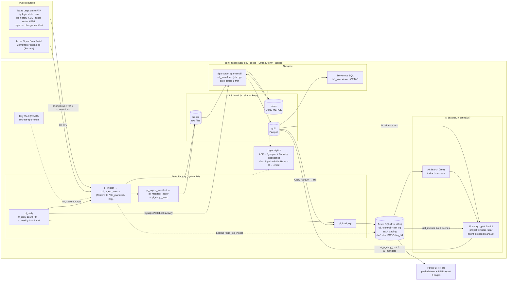
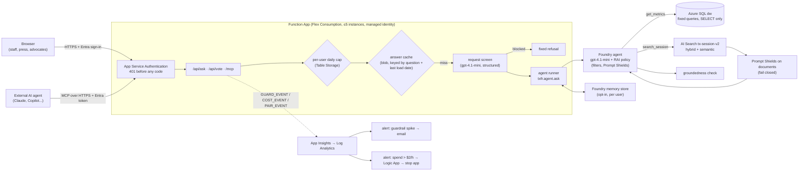

# Architecture

## As built (development, Azure free trial)

| Layer | Service | Choice and why |
| :--- | :--- | :--- |
| Infrastructure | Bicep (`infra/main.bicep`), `infra/up.sh` | One template, one resource group, tags from `shared/TAGGING.md`; what-if before deploy |
| Identity | Managed identities + RBAC | No storage keys (`allowSharedKeyAccess: false`), no SQL passwords (`azureADOnlyAuthentication`), Foundry and Search with local auth disabled |
| Secrets | Key Vault (RBAC mode) | Only the optional Socrata app token; read by a Web activity with `secureOutput` so it never appears in run history |
| Ingestion | Data Factory | Metadata-driven: `ctl.ingest_source` lists every source with a schedule (once / daily / weekly); one generic pipeline per kind |
| Incremental load | Change manifest + folder re-copy | The FTP server reports no modification times, so `modifiedDatetimeStart` is impossible (ADF `UserErrorLastModifiedNotSupported`). The Legislature's `history_periodic.xml` lists the bills changed *today* and resets to an empty `<bills />` after midnight Central, so the incremental runs at 11:30 PM Central (`tr_daily`); an empty manifest is logged as "no change". Only the changed 100-bill folders are re-copied. Watermark = newest manifest timestamp (source clock). Sunday's full copy (`tr_weekly`) reconciles anything a missed day leaves behind |
| Storage | ADLS Gen2, bronze/silver/gold | Bronze keeps the raw files exactly as published (re-parse any time); silver is Delta with MERGE by business key; gold is flat Parquet for SQL and BI |
| Transform | Synapse Spark (Small × 3, auto-pause 5 min) | Parsers are plain Python (`src/txfr`), shipped as a zip with `sc.addPyFile`: no pool package install, same code in tests, Synapse and Databricks |
| Exploration | Synapse serverless SQL | Views over Delta/Parquet and a CETAS snapshot; pay per TB scanned, nothing to keep running |
| Serving | Azure SQL (General Purpose serverless, free offer) | Star schema with SCD type 2 on bill status; one stored procedure loads everything in a transaction and logs to `ctl.load_run` |
| AI extraction | Foundry gpt-4.1-mini, structured outputs | Per-agency costs and duties from fiscal-note prose; every row checked against the note itself (quote present, agency listed, totals reconcile) |
| Agent | Foundry Agent Service + AI Search | Answers cite Legislature files; exact numbers come from fixed SQL queries, never from the model's arithmetic |
| BI | Power BI push dataset + PBIR report via REST / Fabric API | Built from Linux without Desktop; the report definition is versioned in `powerbi/report/` |
| Monitoring | Log Analytics, metric alert, `ctl.ingest_run`, `ctl.load_run` | Pipeline failures email within 5 minutes; every ingest and load writes a row the dashboard's Trust page reads |
| Cost control | Budgets $25/$50/$100 on the resource group, free tiers, auto-pause | See `docs/COSTS.md` |

### Why these, not the alternatives

- **Data Factory, not Synapse pipelines**: Azure data engineering is a broad brief; ADF is the standalone service most
  clients run, and its JSON is the same format Synapse pipelines use. The Synapse notebook activity calls into Synapse.
- **Synapse Spark, not Azure Databricks**: Azure Databricks with Unity Catalog needs pay-as-you-go (blocked on this
  trial, see insurance-docai). The same `txfr` package runs on Databricks unchanged (`tests/test_spark_jobs.py` runs it on
  local Spark).
- **Push dataset, not an Import model**: an Import model on Azure SQL needs a gateway-less OAuth credential bound in the
  service, which the PPU trial and the Linux-only toolchain make awkward. The push dataset is refreshed by
  `python -m txfr.powerbi publish` after each pipeline run. Production uses Import/DirectQuery (below).
- **Copying whole 100-bill folders, not single files**: a Copy activity per changed file costs a minimum billed minute
  each (hundreds per session day); a folder copy covers up to 100 bills for the same minimum.

## Production reference (client network)

What would change to run this for a state agency or the Legislative Budget Board:

| Concern | Development (as built) | Production |
| :--- | :--- | :--- |
| Network | Public endpoints, firewall rules for one IP | Private endpoints for lake, SQL, Key Vault, Search, Foundry; ADF managed VNet integration runtime; Synapse managed VNet with data exfiltration protection |
| Identity | One operator user | Entra groups per role (data engineer, analyst, reviewer); PIM for admin roles; service principals only through workload identity federation (GitHub OIDC) |
| Environments | dev only | dev / test / prod resource groups from the same Bicep with parameter files; ADF git integration, publish branch → ARM template → release pipeline with approvals |
| BI | Push dataset, PPU | Import or DirectQuery semantic model on Azure SQL, scheduled refresh, **row-level security by agency** (`dim_agency` × an agency-user mapping table), deployment pipelines |
| Data retention | 30-day logs | Lake lifecycle policy (bronze → cool after 90 days), SQL point-in-time restore, legal-hold where records rules apply |
| AI | gpt-4.1-mini GlobalStandard; client-side hybrid search; RAI policy + request screen + shields; evals run by hand | Data-zone or regional deployment per data-residency rules; evaluation gate in CI (26-question set, red team, neutrality must not regress); Provisioned Throughput for steady load |
| Monitoring | Email on failure | Action group to the team channel + ticketing; Azure Monitor workbook over `ADFPipelineRun`, `ADFActivityRun`, SQL `ctl.*` |

## Fiscal Note Desk: the agent as a web app and an MCP server (phases A-H)

| Decision | Choice | Why |
| :--- | :--- | :--- |
| Hosting | One Function App (Flex Consumption) for page + API + MCP | Static Web Apps Free can't link a Functions backend and its managed functions have no managed identity; Flex scales to zero and caps instances |
| Auth | App Service Authentication (Entra, single tenant) | Unauthenticated traffic never reaches our code (flood test: 500/500 → 401, no model cost) |
| MCP | Our own stateless JSON-RPC handler, three read-only tools | No preview extension; testable locally; external agents reason, we serve facts with sources |
| Search | Client-side tool, hybrid + semantic over a 256-dim vector index | Best measured retrieval (97% hit@6) and the runner can screen results; Foundry's server-side tool can't be screened by us (documented gap) |
| Guardrails | Five layers: platform RAI policy, request screen, instructions, document shield, groundedness check | Each layer caught something the others missed (EVALUATION.md) |
| Memory | Foundry memory store via REST, opt-in, scope = Entra object id | Consent; and non-personalized answers can be cached |
| Cost | Meter per request (model, screen, embeddings, Content Safety, compute), cache, per-user cap, automatic breaker | Budgets only email; the breaker acts |
| A/B | Offline pairwise judge + optional side-by-side votes in the app | Compare variants on quality; both arms always fully guarded |

### If it were opened to the public

The dev build is signed-in only. Opening it to anyone changes the threat and cost model; the production design:

| Concern | Dev (as built) | Public production |
| :--- | :--- | :--- |
| Edge | App Service Authentication | **Azure Front Door + WAF**: per-IP rate limits, bot protection, geo-filtering, static page cached at the edge; the Function App accepts only Front Door traffic (access restriction on the `AzureFrontDoor.Backend` service tag + `X-Azure-FDID`) |
| API | Function routes | **API Management** in front: products and per-subscription quotas, `llm-token-limit` per caller, `llm-semantic-cache` for repeated questions, backend pool across two regions with circuit breaker |
| Identity | Single-tenant Entra | **Entra External ID** self-service sign-up with email verification and CAPTCHA; anonymous access only to cached answers and the MCP fact tools |
| Capacity | 50K TPM, 5 instances | Higher TPM or Provisioned Throughput for the steady base; a queue (accept, answer asynchronously) instead of 429s at peak; priority tiers (officials, newsrooms) via APIM products |
| Network DDoS | Platform-level protection (always on) | Front Door absorbs L7; Azure DDoS Network Protection only if public IPs/VNets are added |
| Spend | Budgets (email) + breaker at $2/h + $1/user/day | Same pattern with limits sized to the budget; breaker routes to on-call, not just email |

## Architecture and security review (2026-11-10)

A review of the whole system after phases A-H, against the Azure Well-Architected pillars. Code review findings (10)
and their fixes are listed in [EVALUATION.md](EVALUATION.md) and [SECURITY.md](SECURITY.md).

| Pillar | Strengths | Risks and gaps | Recommendation |
| :--- | :--- | :--- | :--- |
| **Security** | No stored credentials; Entra-only data plane; least-privilege identities; five guardrail layers measured by red teams; fail-closed document shield; SQL auditing; guardrail and cost alerts; tested kill switch; CI scans | Public network endpoints (dev); Foundry Knowledge variant's search results aren't screened by us; source FTP has no TLS; agent threads keep users' questions with no retention job | Private endpoints + VNet integration; keep client-side search for anything public; reconcile-and-diff as the FTP integrity control; thread retention job + privacy notice |
| **Reliability** | Idempotent loads (MERGE, transactional procedure); reconciliation every load; SQL reconnect; deploy smoke test; graceful 429s; **warm standby in West US 3 with automatic model failover, degraded search, geo-redundant lake ([FAILOVER.md](FAILOVER.md), 13 acceptance tests)** | Data tier single region (rebuild from lake); free-tier AI Search (no SLA); free SQL pauses (first request after idle waits ~1 min); per-request side-by-side opens fresh SQL connections | Basic+ Search with 2 replicas; serverless SQL with a minimum vCore or an always-on tier; second region behind APIM for the model; connection pool for paired runs |
| **Cost optimization** | Metered per request and per component; cache; per-user cap; automatic breaker; scale to zero everywhere; Developer-tier fine-tune | Guardrails cost as much as the model; agent re-sends ~6k prompt tokens per model call; cache only exact-question matches | Run groundedness only on answers with figures; trim tool schemas; semantic cache (APIM) for near-duplicate questions; Batch API for offline evals |
| **Operational excellence** | Everything as code (Bicep, ADF generator, PBIR, agent definition); one-command deploys; runbook, incident runbook, teardown; evals re-runnable | Evals and red teams are run by hand; two agents to keep in sync; `.env` is the source of truth for some IDs | Evaluation gate in CI on every agent change; write agent IDs to Key Vault or app config; one agent definition module per variant |
| **Performance efficiency** | Measured: ~18 s median per answer; capacity bounded by model TPM, and by output-token *reservations* until runs were capped (45.9 answers/min at 300K with the cap); flood rejected at the edge | 18-25 s answers (agent tool round trips + guardrail calls in series); groundedness and memory calls are synchronous | Stream the answer; run the shield and groundedness in parallel with rendering; pre-compute common metric answers nightly (data changes once a day) |

The most important lesson for the architecture: **every layer earned its place by catching something the others
missed**, and the cheapest controls (sign-in, fixed queries, caps) did the most for cost and abuse. The most
expensive control (groundedness on every answer) is the first candidate to make conditional.
