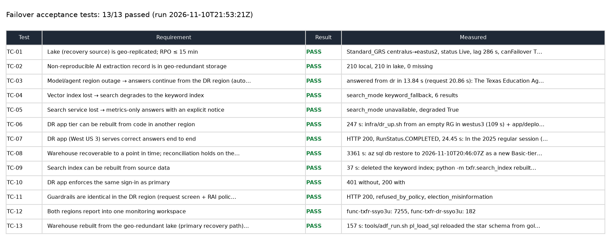
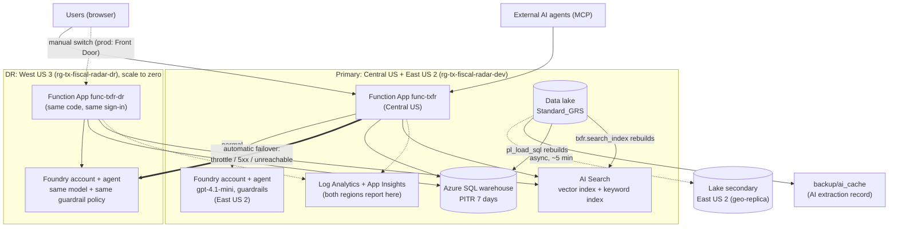
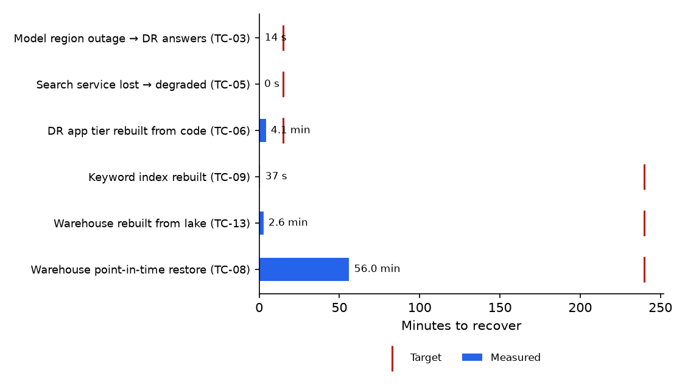

# Failover and disaster recovery: design, tests and acceptance

*Fiscal Note Desk (web app + MCP) and the Texas Fiscal Radar data platform. Tested 2026-11-10 in the development
subscription. All tests are re-runnable with `tools/dr_acceptance.py`; raw results: `docs/eval/dr_acceptance.json`.*

## 1. Summary for sign-off

| | |
| :--- | :--- |
| Scope | Loss of the AI region, loss of search, loss or corruption of the warehouse, loss of the app region's compute, loss of the data lake's region |
| Approach | **Warm standby (pilot light) for everything users touch; rebuild-from-source for the data tier**, which is public and re-derivable |
| Result | **13 of 13 acceptance tests passed** (TC-01 to TC-13); measured recovery times inside every target |
| Standing cost of the standby | ≈ $0 a month in this design: the DR model, agent and Function App are pay-per-use and scale to zero; the lake's geo-redundancy adds cents |
| Open items | §8: listed with owner-ready next steps; none blocks acceptance of the tested scope |



## 2. Recovery objectives

The service is a decision-support tool for budget staff, officials and journalists, not a life-safety system. It is
used most heavily during the legislative session (January-May), on deadlines.

| Tier | What | RTO (time to restore) | RPO (data that may be lost) | Rationale |
| :--- | :--- | :--- | :--- | :--- |
| 1 | Answers: web app, MCP endpoint, model, agent | **15 min** | None (stateless) | What users touch |
| 2 | Warehouse (Azure SQL) and search index | **4 h** | **24 h** (one nightly load) | Re-derivable from public sources and the lake |
| 3 | Data lake (raw files, Delta, gold) | 4 h | **15 min** | The recovery source for tier 2 |
| 4 | User data (opt-in memory, kept questions, feedback) | 24 h | Best effort | Small, opt-in, 30-day retention, disclosed |

## 3. Architecture



| Failure | What happens | Automatic? |
| :--- | :--- | :--- |
| Primary model/agent region throttled, 5xx or unreachable | The runner re-asks the question on the DR agent in West US 3 (new thread there); the answer says `failover: dr` | **Yes** |
| Vector index lost or embeddings unavailable | Search falls back to the keyword index | **Yes** |
| Search service lost | Agent answers from warehouse metrics only and tells the user explanations are unavailable (and doesn't infer absence) | **Yes** |
| Semantic ranker quota exhausted | Falls back to vector search | **Yes** |
| Warehouse lost | **Rebuild from the lake's gold layer with `pl_load_sql`** (2.6 min, TC-13) | Runbook |
| Warehouse corrupted by a bad load | Point-in-time restore to the minute before it (7 days of backups, TC-08) | Runbook |
| Search index lost | Rebuild from SQL + lake (`txfr.search_index`, `txfr.retrieval build`) | Runbook |
| App region (Central US) compute lost | Users switch to the DR app URL (production: Front Door routes automatically) | Manual (dev) |
| Lake region lost | Customer-managed storage failover to East US 2 | Runbook |
| Bad deploy | `app/deploy.sh` smoke test fails the deploy; redeploy the previous commit | Manual |

**Design decisions**

- **Warm standby where it's free.** The usual cost of a standby is idle compute and capacity. Here the model, agent
  and Function App are billed per use, so a second region costs nothing until it serves traffic.
- **Degrade instead of duplicating search.** The free search tier allows one service per subscription; a second paid
  service would cost ≈ $75/month. Metrics-only answers with an honest notice are an acceptable tier-1 degradation.
- **The lake is the backup of record; the warehouse is not replicated.** Everything in SQL is derived from public
  sources through the lake, so a second live database would pay for protection the rebuild path already gives:
  `pl_load_sql` reloads the whole star schema from the geo-redundant lake in 2.6 minutes (TC-13). (The free-offer
  database also refuses geo-redundant backups: *"Only local backup storage redundancy is allowed for Free Limit
  database"*.) Replication (a failover group) becomes worth it only if requirements change: user-entered data stored
  in SQL, or a tier-2 RTO of minutes with the lake region also down.
- **Point-in-time restore is for "undo", not for "gone".** It returns the warehouse to the minute before a bad load
  (7 days of backups). It's slow by nature (§4) and that's fine for its job.
- **Region choice is a feature check, not a map.** South Central US (in-state) was tried first: it supports the Agent
  Service but **not the Function tool** the agent depends on (Microsoft's region matrix). West US 3 supports both.
- **Same controls in DR.** Same Entra sign-in, same RAI guardrail policy, same request screen, same per-user cost cap,
  same telemetry workspace. Verified by TC-10, TC-11, TC-12.

## 4. Measured recovery times



| Scenario | Target | Measured | How measured |
| :--- | ---: | ---: | :--- |
| Model/agent region outage → answers from DR | 15 min | **14 s** (automatic; the time of a normal answer) | TC-03 on the live app |
| Search service lost → degraded answers | 15 min | **0 s** (automatic) | TC-05 |
| DR app tier rebuilt from code, in a new region | 15 min | **4.1 min** (247 s) | TC-06: `infra/dr_up.sh` + `app/deploy.sh dr` |
| Keyword index rebuilt from source | 4 h | **37 s** | TC-09 |
| Vector index rebuilt (embeddings + upload) | 4 h | ≈ 15 min | Phase C build (11,224 docs, 1.55M tokens) |
| **Warehouse rebuilt from the lake** (primary path) | 4 h | **2.6 min** (157 s) | TC-13: `pl_load_sql` |
| Warehouse point-in-time restore (undo a bad load) | 4 h | **56 min** (3,361 s, into the Basic tier) | TC-08 |
| Lake replication lag (RPO) | 15 min | **4.8 min** (286 s) | TC-01 |

**Why the restore took 56 minutes** (122 MB database): a point-in-time restore always creates a *new* database (several
minutes of provisioning regardless of size), copies the last full and differential backups, then replays the
transaction log up to the requested second. The drill restored into the Basic tier to keep the cost to cents; Basic's
small I/O and log rate throttle the replay, so a restore into the source's tier would be faster. Restores also queue
behind others in the region and have no time guarantee. The nightly load rewrites staging and the star schema, so a
day's log is larger than the data. None of this matters for its purpose (undo a bad load, inside 4 h), and it's why
the lake rebuild is the primary path for a lost warehouse.

A real outage adds **detection time** to TC-03: a connection timeout or a 5xx has to happen first (seconds to a minute,
depending on the failure). The simulated outage fails instantly, so 14 s is the answer time, not the detection time.

## 5. Acceptance tests

Run: `.venv/bin/python tools/dr_acceptance.py --live-failover` (TC-08: `--restore-drill`). Each test writes its
requirement, procedure, expected and actual results, timing and a UTC timestamp to `docs/eval/dr_acceptance.json`.

| ID | Requirement | Procedure | Expected | Actual (2026-11-10) | Result |
| :--- | :--- | :--- | :--- | :--- | :---: |
| TC-01 | Lake geo-replicated, RPO ≤ 15 min | Read geo-replication status | GRS, Live, lag ≤ 900 s, failover available | Standard_GRS Central US → East US 2, Live, lag 286 s, failover available | ✅ |
| TC-02 | Non-reproducible AI extraction record is geo-redundant | Compare local cache with lake backup | All files present | 210 local, 210 in lake, 0 missing | ✅ |
| TC-03 | Model/agent outage → answers continue from DR, automatically | Drill flag on the **live** primary app; ask; remove flag | HTTP 200, `failover.to = dr`, correct answer | Answered from DR in 13.8 s: "The Texas Education Agency has the largest new two-year cost…" | ✅ |
| TC-04 | Vector index lost → keyword fallback | Point search at a missing index | `keyword_fallback`, results | `keyword_fallback`, 6 results | ✅ |
| TC-05 | Search service lost → metrics-only with notice | Point search at a non-existent service | `degraded: true`, notice | `unavailable`, degraded true; agent told the user | ✅ |
| TC-06 | DR app tier rebuildable from code in another region | `infra/dr_up.sh` from an empty RG + `app/deploy.sh dr` | Completes; smoke test 200 | 109 s + 138 s = 247 s; smoke 200 | ✅ |
| TC-07 | DR app serves correct answers end to end | Ask the DR URL a question with a known answer | 200; 1,187 enacted (607 + 580) | 200, completed, 607 HB + 580 SB, 24 s | ✅ |
| TC-08 | Warehouse restorable to a point in time; reconciliation holds | Restore to 10 min ago as a new DB; query; delete | Restore succeeds; 1,213 = 1,213 | Restored in 3,361 s (56 min); copy: 10,635 bills, 1,213 = 1,213; copy deleted | ✅ |
| TC-09 | Search index rebuildable from source | Delete keyword index; rebuild | Completes | 11,224 docs in 37 s | ✅ |
| TC-10 | DR enforces the same sign-in | `/api/health` without / with token | 401 / 200 | 401 / 200 | ✅ |
| TC-11 | DR enforces the same guardrails | Send a public-trust attack to DR | `refused_by_policy` | `refused_by_policy`, election_misinformation | ✅ |
| TC-12 | Both regions report into one monitoring workspace | Telemetry by app role, last 2 h | Rows from both apps | primary 7,255, DR 182 | ✅ |
| TC-13 | Warehouse rebuilt from the geo-redundant lake (primary recovery path) | `tools/adf_run.sh pl_load_sql`; check reconciliation | Completes; 1,213 = 1,213 | 157 s; 1,213 = 1,213 | ✅ |

### Captured output

Failover on the live primary app (TC-03, from the drill run):

```text
status RunStatus.COMPLETED | total s 15.86
failover {"to": "dr", "reason": "ConnectionError: simulated primary region outage (drill)", "seconds_to_answer": 14.71}
The agency with the second-largest new two-year cost from enacted 2025 bills is the Comptroller of Public Accounts,
with an attributed cost of about $305 millio…
simulation flag removed
```

Degraded search (TC-04/05) and the agent's answer with search lost:

```text
index lost -> keyword_fallback 6
service lost -> unavailable True
agent: RunStatus.COMPLETED ['school vouchers', 'session_funnel', 'school vouchers']
… The fiscal-note search is currently unavailable, so I cannot provide detailed cost information or explanations
from fiscal notes on this topic.
```

Lake geo-replication (TC-01):

```json
{"canFailover": true, "canPlannedFailover": true, "lastSync": "2026-11-10T21:03:22+00:00",
 "primary": "centralus", "secondary": "eastus2", "sku": "Standard_GRS", "status": "Live"}
```

Index rebuild (TC-09):

```text
keyword index deleted
11224 documents: bill_card=10635, agency_card=95, note_section=494
uploaded 11224/11224 to index tx-session
keyword index rebuilt from SQL + lake in 37s
```

Full acceptance run:

```text
TC-01  PASS  Standard_GRS centralus→eastus2, status Live, lag 286 s, canFailover True
TC-02  PASS  210 local, 210 in lake, 0 missing
TC-04  PASS  search_mode keyword_fallback, 6 results
TC-05  PASS  search_mode unavailable, degraded True
TC-07  PASS  HTTP 200, RunStatus.COMPLETED, 24.45 s: In the 2025 regular session (89R), the number of bills enacted were…
TC-10  PASS  401 without, 200 with
TC-11  PASS  HTTP 200, refused_by_policy, election_misinformation
TC-12  PASS  func-txfr-<suffix>: 7255, func-txfr-dr-<suffix>: 182
TC-03  PASS  answered from dr in 13.84 s (request 20.86 s): The Texas Education Agency has the largest new two-year cost…
11/11 passed → docs/eval/dr_acceptance.json
```

## 6. Runbooks

| Event | Detect | Act | Verify |
| :--- | :--- | :--- | :--- |
| Model region degraded | `failover` in answers; App Insights `AppTraces` | Nothing (automatic). If prolonged: raise DR capacity (`chatCapacityK` in `infra/dr.bicep`) | TC-03 |
| Search down | Degraded answers; search 5xx | Nothing (automatic). Rebuild if the index is gone: `python -m txfr.search_index`; `python -m txfr.retrieval build` | TC-04/05, TC-09 |
| Warehouse lost | Connection failures; database missing | Recreate the database (`infra/up.sh`), `sql/*.sql`, then `tools/adf_run.sh pl_load_sql` | TC-13 |
| Warehouse corrupted (bad load) | Trust page reconciliation ≠ official; `ctl.load_run` Failed | Restore to before the bad load: `az sql db restore … --time <UTC>`, verify, swap names | TC-08 |
| App region down | Health probe / users | Point users at the DR URL (`DR_APP_URL`); production: Front Door does this | TC-07, TC-10 |
| DR app missing (fresh region) | | `infra/dr_up.sh`, `python -m txfr.agent create dr`, `infra/dr_up.sh` (sets the agent id), `infra/app_auth.sh`, `sql/04_app_identity.sql` for the DR identity, `app/deploy.sh dr` | TC-06 |
| Lake region down | Storage availability | `az storage account failover -n <lake>` (customer-managed; the account becomes LRS in East US 2; re-enable GRS after) | TC-01 (readiness) |
| Laptop lost (AI cache) | | `python tools/dr_backup.py pull` | TC-02 |
| Pipeline missed nights | No new `ctl.ingest_run` rows | `tools/adf_run.sh pl_ingest '{"mode":"weekly"}'` (full copy of the live session) | RESULTS.md |

## 7. Production target design (beyond this dev build)

| Concern | Dev (tested here) | Production |
| :--- | :--- | :--- |
| Routing | Separate DR URL, manual switch | **Azure Front Door** with health probes on `/api/health` across both apps; automatic, ~1-2 min |
| Model | Runner-level failover to a second Foundry account | **API Management** backend pool across regions with circuit breaker; Provisioned Throughput for the base load + Global Standard spillover |
| Warehouse | Rebuild from the geo-redundant lake (2.6 min) + PITR for undo | **Same pattern** (the data is re-derivable). Add a failover group only if SQL starts holding data that can't be rebuilt |
| Search | One free service + degraded mode | Standard tier, 2+ replicas per region, index in both regions (re-indexed by the pipeline) |
| Agent state | Threads/memory regional, not replicated | **Standard agent setup**: threads in your Cosmos DB with multi-region writes; memory re-derivable |
| Lake | GRS, customer-managed failover | RA-GZRS (zone + geo, readable secondary) |
| Testing | Drills on demand | Quarterly DR test with this suite in CI, results archived; game days during the interim, not the session |

## 8. Known issues and limits (found by these tests)

| # | Finding | Impact | Status / next step |
| :- | :--- | :--- | :--- |
| 1 | The DR app returned **503 for ~10 minutes** after its first idle period; a restart fixed it and it didn't recur. It had no telemetry then, so the cause is unknown | A cold standby can fail silently | DR app now reports to App Insights (TC-12); production adds Front Door health probes so a dead standby is visible before it's needed |
| 2 | The operator's own account is refused for threads in the DR project although it can create agents there; the app identities work | Operators can't drill from a laptop in DR; the production path (app identity) is unaffected | Open; drills run through the app (TC-03, TC-07) |
| 3 | Failover can't reuse the primary's thread or memory: the DR answer is a fresh thread, without personalization | A user mid-conversation loses context during an outage | Accepted for tier 4; Standard agent setup in production |
| 4 | South Central US lacks the Function tool | A plausible in-state DR region doesn't work for this agent | Documented; West US 3 used |
| 5 | Free-offer SQL can't use geo-redundant backups | No cross-region restore of the database itself | By design: the lake (GRS) is the recovery source; rebuild measured at 2.6 min (TC-13) |
| 6 | Real-outage detection time is not measured (simulated failure is instant) | TC-03's 14 s excludes detection | Production: APIM circuit breaker with configured thresholds |
| 7 | The Foundry Knowledge agent variant has no DR copy | A/B side-by-side unavailable during an outage | Accepted (optional feature) |

## 9. Acceptance criteria

The client accepts the failover capability when:

- [x] Every test TC-01 to TC-13 passes on a run within the last 30 days (`docs/eval/dr_acceptance.json`).
- [x] Measured recovery times are inside the §2 targets (§4).
- [x] The DR region enforces the same authentication, guardrails, cost caps and monitoring as the primary (TC-10/11/12).
- [x] The standby can be rebuilt from code alone in a new region (TC-06).
- [x] Each failure in §3 has a runbook (§6) with a verification test.
- [x] Known issues are documented with impact and next steps (§8).
- [ ] Production items in §7 are scheduled (client decision; not part of the tested scope).
