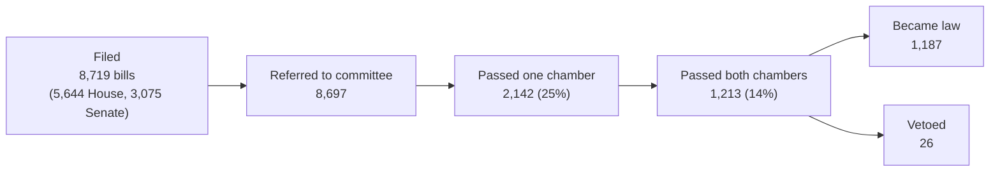

# How the Texas Legislature works, as its own records show it

*Why this project exists: to understand the inner workings and outcomes of the Texas Legislature from the 2025
session's complete record, before the 90th Legislature convenes on **January 12, 2027**, and then to follow that
session as it happens. Every number below comes from the Legislature's public files (bill histories and Legislative
Budget Board fiscal notes) as loaded into this project's warehouse; nothing is from news coverage.*

## The shape of a session: 2025 (89th Legislature, regular session)

Five things the record shows about how the Legislature actually works:

**1. Most of the work happens before the session and at the deadlines.**
- **2,383 bills (27%) were filed before the session opened**, during prefiling, which started in November 2024. Only 249
  of them (10%) became law.
- **2,523 bills (29%) were filed in the final week before the filing deadline** (March 8-14, 2025, around the 60th day).
- **963 of the 1,213 bills that passed both chambers (79%) did so in the last two weeks** (May 18 to June 2, 2025, the
  140th day). The end of a session is a crunch.

**2. Committees are where most bills stop.** Almost every bill is referred to a committee, and three in four never pass
even one chamber. The busiest committees are the biggest graveyards:

| Committee (2025) | Bills referred | Still in committee at the end | Became law |
| :--- | ---: | ---: | ---: |
| House Public Education | 679 | 556 (82%) | 54 |
| House State Affairs | 578 | 405 (70%) | 73 |
| Senate Business & Commerce | 573 | 341 (60%) | 169 |
| Senate Health & Human Services | 537 | 324 (60%) | 150 |
| Senate State Affairs | 530 | 311 (59%) | 113 |

**3. The governor acts after the session ends.** Of the bills that became law, 328 were signed in May and 844 in June,
after the Legislature adjourned. All 26 vetoes fell between May 24 and **June 22, 2025**, the last day of the governor's
20-day window after adjournment.

**4. Most new laws cost the state nothing measurable; a few cost a great deal.** Of 1,186 bills enacted in the regular
session, **110 had a two-year cost** in their fiscal note. Together they add about **$16.8 billion** of 2026-27 spending,
and one bill, HB 2 (school finance), is half of it. Appropriations bills, which fund many agencies at once (HB 500,
$13.2 billion), are a separate category.

**5. Cost estimates move as a bill moves.** Each version of a bill gets a new fiscal note. Of enacted bills with more
than one note, **49 changed by more than 25%** between the first and the last; the homestead exemption (SB 4) went from
$1.0 billion to $2.7 billion. Watching the *latest* note matters.

**And sessions don't always end on day 140.** The 2025 regular session was followed by two special sessions: the first
(891) filed 369 bills and passed none; the second (892) filed 368 and enacted 20.

## The 2027 calendar: what to watch

Dates follow the Texas Constitution and the pattern of the 2025 session (which convened January 14, 2025, adjourned
June 2, and saw its last veto on June 22).

| Date | What happens | What to watch in this project |
| :--- | :--- | :--- |
| **Nov 9, 2026** (passed) | Prefiling opened | 1,179 House and Senate bills on day one (Session pulse page; filing-pace chart vs 2025) |
| **Jan 12, 2027** | 90th Legislature convenes (second Tuesday of January) | Committee assignments; first referrals appear in bill histories |
| **~Mar 12, 2027** | 60th day: last day to file most bills without a supermajority | The filing surge (2025: 29% of all bills in the final week) |
| **Mar-May 2027** | Committee hearings, floor votes, fiscal notes for each new version | Bills leaving committee; estimate drift on the bills you follow |
| **~May 31, 2027** | 140th day: regular session ends (sine die) | The last-two-weeks crunch (2025: 79% of final passages) |
| **~June 20, 2027** | Governor's veto deadline (20 days after adjournment) | Signed vs vetoed |
| **Sept 1, 2027** (typically) | Most new laws take effect, unless passed with immediate effect | Agency implementation dates and costs (Readiness page) |

## How to follow it with this project

| Question | Where |
| :--- | :--- |
| What has been filed so far, and how fast compared with 2025? | Power BI → Session pulse; agent: "How many bills have been filed so far for 2027?" |
| Which 2027 bills touch my agency? | Power BI → Watchlist; agent: "Which 2027 bills name the Texas Education Agency?" |
| What will a bill cost, and has the estimate changed? | Agent: "What does the latest fiscal note say SB 4 costs?"; Power BI → Estimate drift |
| Which agencies took on the most new work last time? | Power BI → Fiscal exposure and Readiness |
| Where do bills like this usually stall? | Power BI → Session pulse (committee bottlenecks) |

The pipeline loads the Legislature's change list every night at 11:30 PM Central and a full copy every Sunday, so the
2027 numbers stay current through the session. The assistant answers about what has been filed and estimated; it
doesn't predict what the Legislature will do.

## Limits of this view

- Fiscal notes are the Legislative Budget Board's estimates of a bill's version at a point in time, not appropriations.
- A fiscal note's "source agencies" are the agencies consulted, not necessarily the ones that pay.
- The bill-history "effective" action is recorded on the day it's entered (usually the signing date); the actual
  effective date is in the action's text, which this warehouse doesn't parse yet. So "when do 2025 laws take effect"
  isn't answered from the data here.
- This is an independent analysis of public records, not affiliated with the Legislature or any agency.
