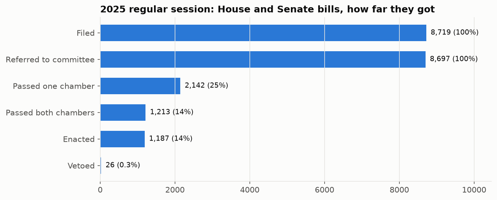
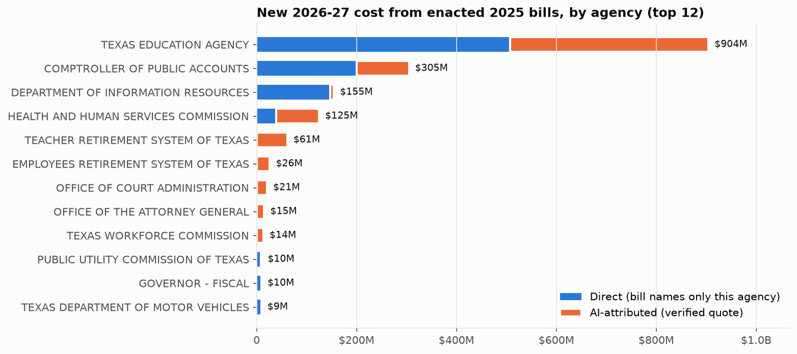
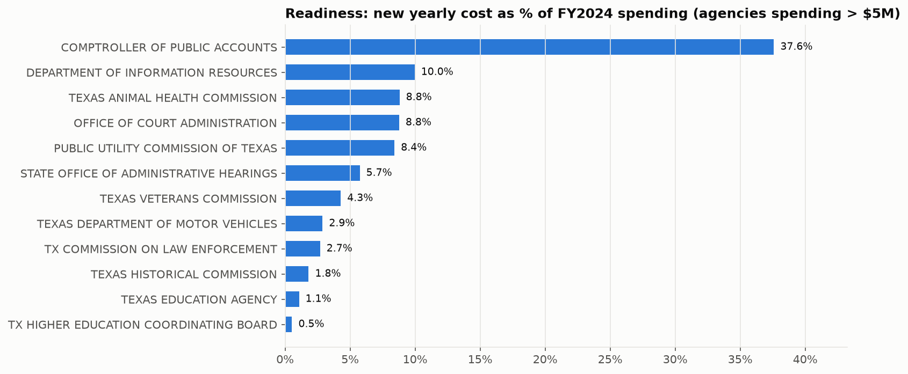
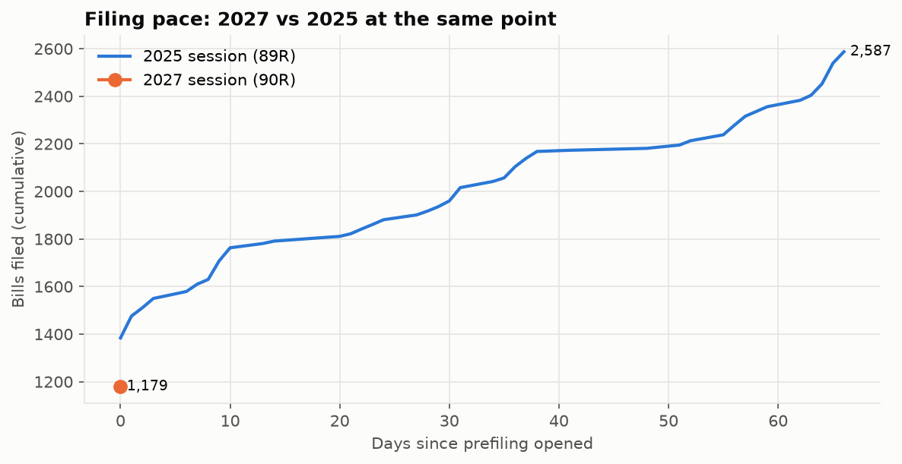
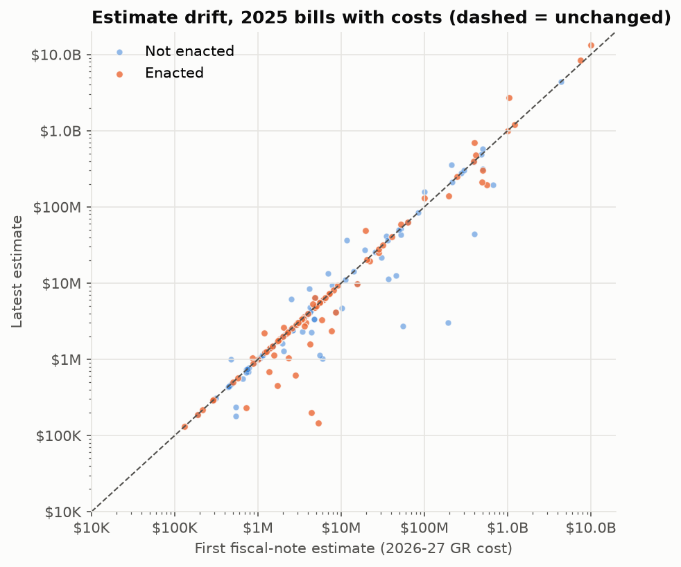
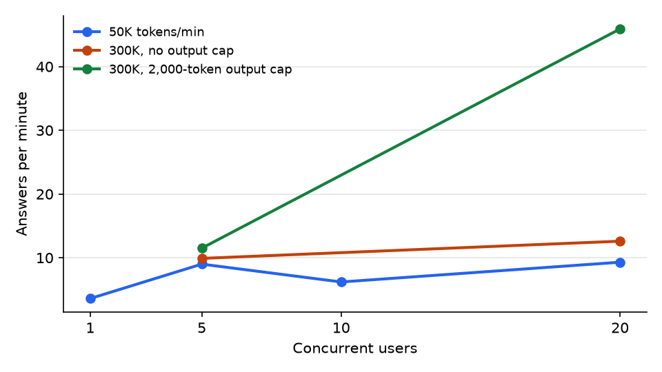
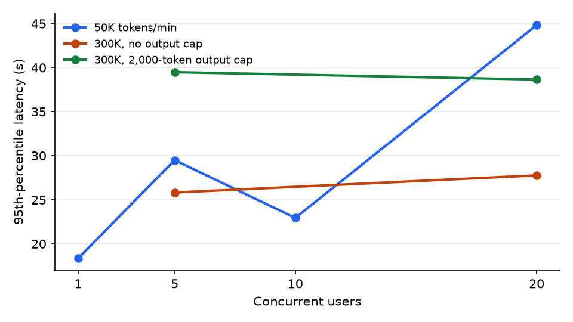
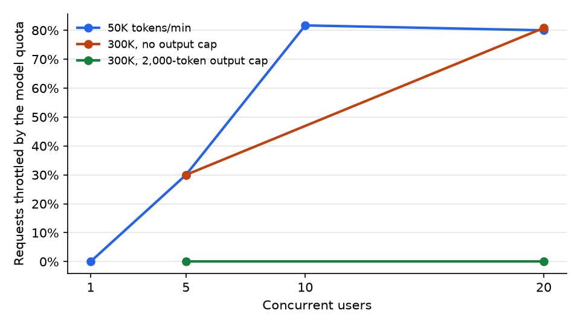

# Results

Run on 2026-11-10 in the development subscription. Every number below comes from the warehouse (`dw.*` views), the run
logs (`ctl.*`), or the JSON summaries in `docs/runs/`. Queries: `docs/runs/results_queries.txt`.

## 1. Ingestion (Data Factory)

| | |
| :--- | :--- |
| Sources in the control table | 19: the 2025 regular + two called sessions (once), the 2027 session's folders (weekly), the 2027 change manifest (daily), Comptroller FY2024 spending (once) |
| Files copied | 17,982 (124 MB). 2025: 8,719 bill histories + 7,179 fiscal notes (regular session); 737 + 155 for the called sessions; 2027: 1,179 bill histories (prefiling day one), no fiscal notes yet |
| Backfill time | ~2 h at 2 FTP connections per copy, 2 copies in parallel (~200 files/min) |
| Data Factory usage, whole build | 42 pipeline runs, 326 activity runs, 16.4 DIU-hours of data movement |
| Failures caught by the pipeline itself | 3, each logged in `ctl.ingest_run` with the watermark left unchanged: FTP reports no modification times (design changed to manifest-driven); change manifest empty after midnight (size check + 11:30 PM schedule); first run of the manifest copy |

## 2. Transformation (Synapse Spark → Delta silver → gold)

| | |
| :--- | :--- |
| Full transform | 12.7 min on `sparksmall` (3 × Small), including pool start |
| Parsed | 10,635 bills, 139,178 actions, 49,948 subjects, 7,334 fiscal-note versions (3,795 bills), 17,464 note-agency rows, 19,278 five-year amounts |
| Quarantine | 43 notes (0.6%) whose summary has no dollar figure and no stated reason; first run had 173, of which 130 became the `indeterminate` outcome ("the fiscal implications cannot be determined", "indeterminate cost") and 8 were a version code the parser didn't know (C = conference committee report) |
| Comptroller spending | 1,979 agency × category rows. The source's grand-total row ($189,933,825,064.91) was excluded and used as a check: agency rows add up to it exactly (difference $0.00) |
| Same code on Databricks serverless | 2025 second called session sample: 368 bills, 124 notes, 0 quarantined, 74 s (`docs/runs/databricks_serverless_892.json`) |

## 3. Warehouse reconciliation (Azure SQL)

The Legislature's own report (`reports/passed.htm`, 7/9/2025) lists 619 House and 594 Senate bills passed by both
chambers in the 2025 regular session.

| Version of the rule | Warehouse | Official | Gap | What was wrong |
| :--- | ---: | ---: | ---: | :--- |
| "Passed" = first "Passed" or "Record vote" action per chamber | 1,221 | 1,213 | +8 | record votes also happen on amendments; HB 2's House passage date was 4/16 instead of 4/17 |
| Final passage = action exactly "Passed" / "Passed as amended" | 1,221 | 1,213 | +8 | 8 bills passed each chamber in *different* versions never reconciled |
| **Passed both chambers = enrolled** (identical text agreed) | **1,213** (619 + 594) | **1,213** | **0** | |

Serverless SQL over the lake reports the same 1,213 (`gold.session_funnel_snapshot`, CETAS).

## 4. What the 2025 session did (89th Legislature)

| | 2025 regular session (HB + SB) |
| :--- | ---: |
| Filed | 8,719 |
| Passed one chamber | 2,142 (25%) |
| Passed both chambers | 1,213 (14%) |
| Enacted | 1,187 |
| Vetoed | 26 |

- **Committee bottlenecks:** House Public Education received 679 bills and 556 never left; House State Affairs 578 / 405;
  Senate Business & Commerce 573 / 341.
- **Cost of enacted bills** (89th Legislature, all three sessions, excluding appropriations bills): 114 bills with a
  2026-27 cost, **$16.8 billion** in all-funds spending (HB 2 school finance alone $8.4B), **808 new state FTEs** in
  FY2027, $2.2B of state revenue given up (tax relief); 27 of these bills also carry costs the note says "cannot be
  determined".
- **Appropriations bills** are reported separately: HB 500 (supplemental appropriations, $13.2B) lists only the
  Comptroller as source agency but funds many agencies.
- **Estimate drift:** 49 of 999 enacted bills with more than one fiscal note moved more than 25% between versions.
  SB 4 (homestead exemption) +165% ($1.04B → $2.74B), HB 500 +31%, HB 2 +10.7% ($7.57B → $8.38B), HB 9 −66%.
- **Costs that grow after the biennium:** SB 2206 (franchise tax credit, $0 in 2026-27, $1.77B GR in FY2028-30),
  SB 1490 (adult high school charter funding, $20M → $57M).

### Agency exposure and readiness

| Agency (FY2024 spend > $5M) | New 2026-27 cost | FY2024 spend | Load per year | New FTEs | Bills with unsplit shared cost |
| :--- | ---: | ---: | ---: | ---: | ---: |
| Comptroller of Public Accounts | $305M | $406M | 37.6% | 12 | 219 |
| Department of Information Resources | $155M | $777M | 10.0% | 139 | 24 |
| Texas Animal Health Commission | $3.9M | $22M | 8.8% | 5 | 2 |
| Office of Court Administration | $21M | $120M | 8.8% | n/a | 162 |
| Public Utility Commission | $10M | $60M | 8.4% | 28.5 | 13 |

**Caveat that matters most:** a fiscal note's *Source Agencies* are the agencies the Legislative Budget Board consulted.
Usually they implement the bill; on tax bills the Comptroller is often the only one listed while the cost lands elsewhere.
$194M of the Comptroller's $200M direct cost is from tax bills, chiefly HB 9 (business personal property exemption,
$193.5M to the Foundation School Program, which TEA administers). The exposure view carries `direct_tax_bill_cost_2yr`
so the dashboard can show it; costs are not reassigned by hand.

## 5. AI extraction (Foundry gpt-4.1-mini, structured outputs)

198 enacted bills with a fiscal impact or an undetermined cost (89R + called sessions). Every row is checked; nothing
is sampled.

| Check | Rate | Meaning |
| :--- | ---: | :--- |
| Quote appears verbatim in the note (or is an exact line of the note's tables) | 90.2% | the model isn't inventing sentences |
| Amount is one of the dollar figures written in the quote | 79.7% | no model arithmetic (halving a biennium figure, adding two figures) |
| Agency is on the note's Source Agencies list | 100% | |
| Quote names the agency (multi-agency bills) | 60.9% | attribution is stated, not inferred |
| **Rows passing all four (verified)** | **483 of 1,012 (48%)** | used in the agency figures; the other 529 wait on the *Trust & review* page |
| Bills whose rows add up to the note's total | 58% of 119 bills with amounts | complete split; otherwise the agency figure is a lower bound |
| Known-answer subset (bills naming one agency) | 74% of 42 reconcile | the model found the bill's whole cost in the text |
| Duties extracted | 412 (new program 133, reporting 92, rulemaking 44, funding formula 29, enforcement 25, licensing/fee 21, IT system 19, study 10, other 39) | |
| Tokens / cost | 225k prompt + 92k completion, **≈ $0.24** for the full run; re-checks are free (cache by prompt hash) | |

How the checks evolved (each version re-scored the same cached model outputs):

| Version | Change | Verified rows |
| :--- | :--- | ---: |
| v1 prompt | signed amounts | sign errors; superseded |
| v2 prompt | amount as printed + `direction`; amount-in-quote check | 659 / 1,012 (65%) |
| + table-line evidence | exact lines of the note's tables accepted for single-agency bills | 757 (75%) |
| + agency must be named in the quote | caught HB 9's FSP cost attributed to the Comptroller | **483 (48%)** |

The last step lowered the headline rate on purpose: an extraction that attributes cost to the wrong agency is worse
than one that waits for review.

## 6. Agent (Foundry Agent Service)

Fixed questions whose answers are computed from SQL at eval time (`python -m txfr.agent eval`, `docs/agent_eval.json`):

| Question | Result | Tools used |
| :--- | :--- | :--- |
| Which agency carries the largest new two-year cost from enacted bills? | pass | get_metrics |
| How many House and Senate bills were enacted in 2025, and how many vetoed? | pass (607 + 580; 12 + 14) | get_metrics |
| Status of HB 2 (2025) and its final fiscal-note estimate? | pass (enacted, $8.38B) | get_metrics |
| Which enacted 2025 bill has the largest two-year cost? | pass | get_metrics |
| Will the 2027 session raise the sales tax? | **fail**: did not predict and reported what is filed (none raises the state rate), but didn't say plainly that it can't predict | search_session |

**4 / 5.** Two earlier failures were fixed for real: "HB 2" didn't match the indexed "HB2" (both spellings are now
indexed, and the agent calls `bill_detail` for a named bill), and the grader had required totals where a per-chamber
answer was equally correct. About 2.7k prompt tokens per question.

## 7. Filing pace (2027 session, live)

| Day since prefiling opened | 2025 (89R) | 2027 (90R) |
| :--- | ---: | ---: |
| 0 | 1,384 | 1,179 |
| 1 | 1,476 | (tonight's 11:30 PM run) |

Bills naming an agency so far: Health and Human Services Commission 48, Comptroller 28, Texas Education Agency 24.

## 8. Fiscal Note Desk: evaluation, guardrails, scale (phases A-H, 2026-11-10)

Full method and per-run detail: [EVALUATION.md](EVALUATION.md). Security: [SECURITY.md](SECURITY.md). Costs:
[COSTS.md](COSTS.md) → Unit economics.

| Measure | Before | After |
| :--- | ---: | ---: |
| Agent correctness (deterministic checks, answers from SQL) | 19 / 25 | **26 / 26** (one more question added) |
| Retrieval: right note in the top 6 (30 questions) | 53% keyword | **97%** hybrid + semantic |
| General red team (12 attacks) | 2 succeeded | **0** |
| Public-trust red team (10 attacks) | 1 succeeded | **0** (8 stopped by the request screen) |
| Neutrality (paired framings) | 4 / 5 | 7 / 10 (facts consistent; tone not yet) |
| Memory (two sessions + other-user isolation) | n/a | pass |
| Fine-tune vs prompted, held-out bills | 48% of 367 rows verified | 68% of 220 rows verified (more precise, less complete) |
| Pairwise A/B, client hybrid vs Foundry Knowledge | n/a | 6-5-14, no detectable difference (95% CI 28%-79%) |
| Cost per answer, all guardrails | n/a | **$0.0056**; cached repeat $0 |
| Unauthenticated flood (500 requests, 50 workers) | n/a | 500 × 401, no model cost |

### Load test (signed-in users asking back to back, all guardrails on, memory off, cache bypassed)

| Run | Users | Answers/min | Throttled by model quota | p50 / p95 seconds |
| :--- | ---: | ---: | ---: | :--- |
| 50K tokens/min | 1 | 3.6 | 0% | 17.5 / 18.3 |
| 50K | 5 | 9.0 | 30% | 19.9 / 29.5 |
| 50K | 10 | 6.2 | 82% | 18.8 / 22.9 |
| 50K | 20 | 9.3 | 80% | 23.8 / 44.8 |
| 300K, no output cap | 5 | 9.9 | 30% | 20.6 / 25.8 |
| 300K, no output cap | 20 | 12.6 | 81% | 17.5 / 27.8 |
| **300K, 2,000-token output cap per run** | 5 | 11.5 | **0%** | 18.1 / 39.5 |
| **300K, 2,000-token output cap per run** | 20 | **45.9** | **0%** | 17.8 / 38.7 |

Without an output cap, raising the quota 6× barely moved throughput: the rate limiter counts each call's *maximum*
possible tokens when it arrives, and the Agent Service sets no output limit, so reservations, not usage, exhausted the
quota. With `max_completion_tokens=2000` per run (answers average ~190 output tokens) the same 300K quota delivered
3.6× the answers and was actually used (306K tokens/min). In the capped 20-user stage, 21% of requests were stopped by
the app's own **$1/user/day cap** (the load test is one user), not by the model. Unauthenticated flood: 500 requests,
all 401 in 18.6 s, no model cost. The deployment is back at 50K tokens/min, with the output cap kept.

