# Status for review (2026-11-10)

What is live, what it shows, and what to look at first. Numbers come from [RESULTS.md](RESULTS.md).

## What is running

| Piece | State | Where |
| :--- | :--- | :--- |
| Power BI semantic model (push dataset, 10 tables loaded from the SQL views) | **Published 2026-11-10** | workspace `tx-fiscal-radar` → *Texas Fiscal Radar* |
| Power BI report (6 pages, 34 visuals, PBIR from `src/txfr/powerbi.py`) | **Published 2026-11-10** | same workspace → report *Texas Fiscal Radar* |
| `tr_daily`: incremental ingest → Spark → SQL load | **Started**, every day 11:30 PM Central; first run Wed 2026-11-11 | Data Factory → Manage → Triggers |
| `tr_weekly`: full copy of the live session + Delta OPTIMIZE/VACUUM | **Started**, Sundays 5:00 AM Central | same |
| Foundry agent `tx-session-analyst` | Created; `python -m txfr.agent ask "..."` | Foundry project (eastus2) |
| Budgets $25 / $50 / $100 per month + failed-run alert | Active | resource group `rg-tx-fiscal-radar-dev` |

Expected run cost with the triggers on: **about $0.60 a day, roughly $20 a month** ([COSTS.md](COSTS.md)). To stop them, use ADF Studio or:

```bash
set -a; source .env; set +a
for t in tr_daily tr_weekly; do
  az rest --method post --url "https://management.azure.com${DATA_FACTORY_ID}/triggers/$t/stop?api-version=2018-06-01"
done
```

The Power BI dataset is a **push dataset**: it does not refresh itself. After a pipeline run, `python -m txfr.powerbi publish`
reloads it (it needs the `~/.azure-powerbi` login, which expires; see [RUNBOOK.md](RUNBOOK.md)). Wiring that into the
daily run is the next step, with a service principal in place of the personal login (see *Next* below).

## Fiscal Note Desk (web app + MCP), live since 2026-11-10

| Piece | State |
| :--- | :--- |
| Web app `func-txfr-*` (page, `/api/ask`, `/api/vote`, `/api/feedback`, `/privacy`) | Live behind Entra sign-in (401 without it) |
| MCP endpoint `/mcp` (`get_metrics`, `search_fiscal_notes`, `bill_detail`) | Live, same sign-in; `claude mcp add` steps in QUICKSTART |
| Agents | `tx-session-analyst` (default, hybrid search) and `tx-session-analyst-knowledge` (Foundry server-side search); side-by-side A/B on 10% of questions or on request |
| Guardrails | RAI policy (hate Low), request screen, Prompt Shields on documents (fail closed), groundedness check |
| Alerts (email azure@willieman.com) | Pipeline failure; guardrail spike (≥5 in 15 min); **cost breaker** (> $2/h → app stopped automatically) |
| Cost controls | Answer cache, $1/user/day cap, 5-instance cap, 50K TPM model quota |
| Privacy defaults | Questions not kept; pseudonymous logs; memory and "help improve" opt-in |

Daily checks: `tools/killswitch.sh status`; `tools/retention.py --delete` (kept threads past 30 days). Screenshots
of the app are in `docs/img/app/`.

## The report, page by page

| Page | Question it answers | Reads from |
| :--- | :--- | :--- |
| Session pulse | How far did 2025's bills get, and where did they stall? | `v_session_funnel`, `v_committee_bottleneck` |
| Fiscal exposure | Which agencies picked up the most new 2026-27 cost from enacted bills? | `v_agency_exposure`, `v_bill_cost` |
| Readiness | How big is that cost compared with what the agency spent in FY2024? | `v_agency_exposure` |
| Estimate drift | Which bills' cost estimates moved most between versions? | `v_estimate_drift` |
| Watchlist (2027) | What's been prefiled for 2027 and how fast is filing running vs 2025? | `v_watchlist`, `v_filing_pace` |
| Trust & review | Which AI-extracted rows failed a check, and why? Data quality checks. | `ai_review`, `v_data_quality` |

Screenshots below are from the published report on 2026-11-10, captured in a signed-in browser (the export API needs
Premium/Fabric capacity; this workspace is on shared capacity).

### 1. Session pulse
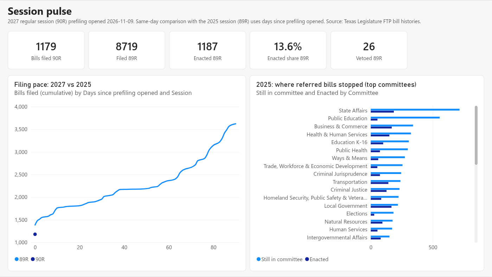

2027 prefiling (1,179 bills on day 1) against 2025's cumulative pace; the committees where 2025 bills stopped.

### 2. Fiscal exposure
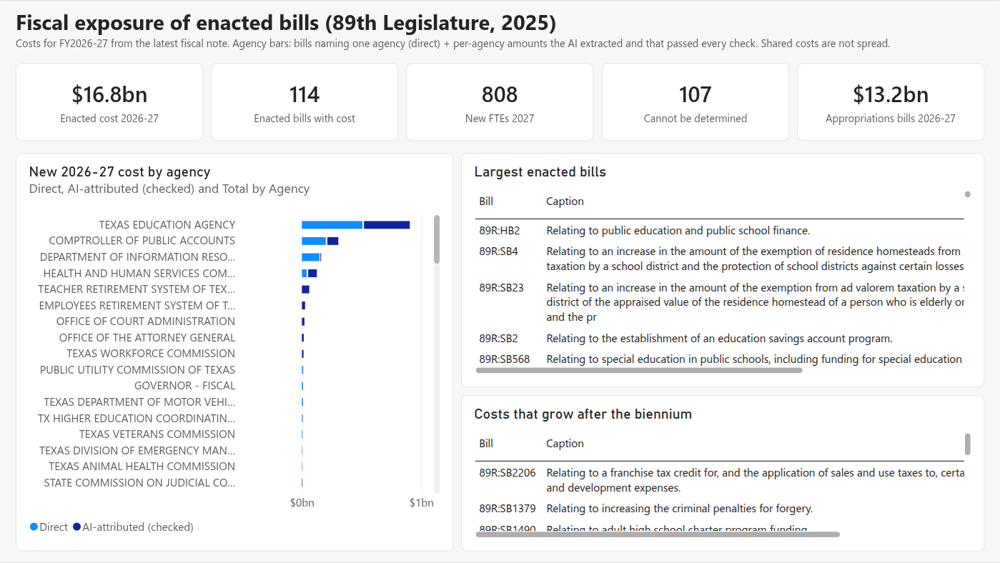

$16.8bn / 114 bills / 808 jobs, the same numbers as RESULTS.md. Appropriations bills ($13.2bn, HB 500) get their own card
and are kept out of the agency bars. Light bars = bills naming one agency; dark = AI-extracted amounts that passed every check.

### 3. Readiness
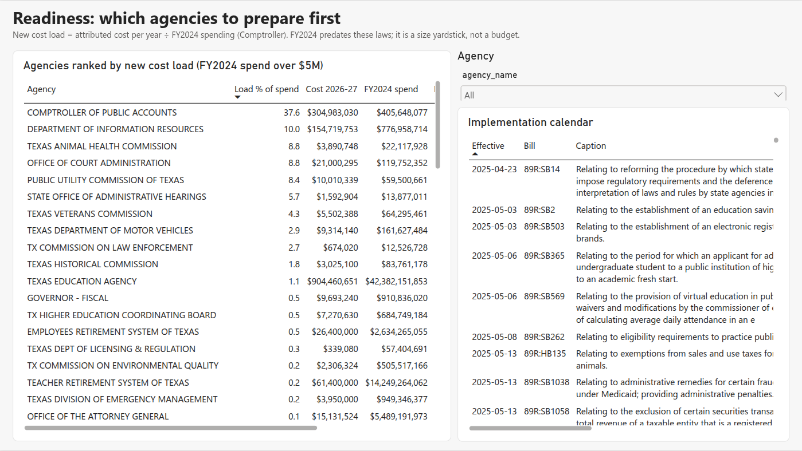

Ranked only for agencies that spent more than $5M in FY2024: below that, one small bill gives a meaningless ratio
(the State Commission on Judicial Conduct showed 131% before this filter).

### 4. Estimate drift
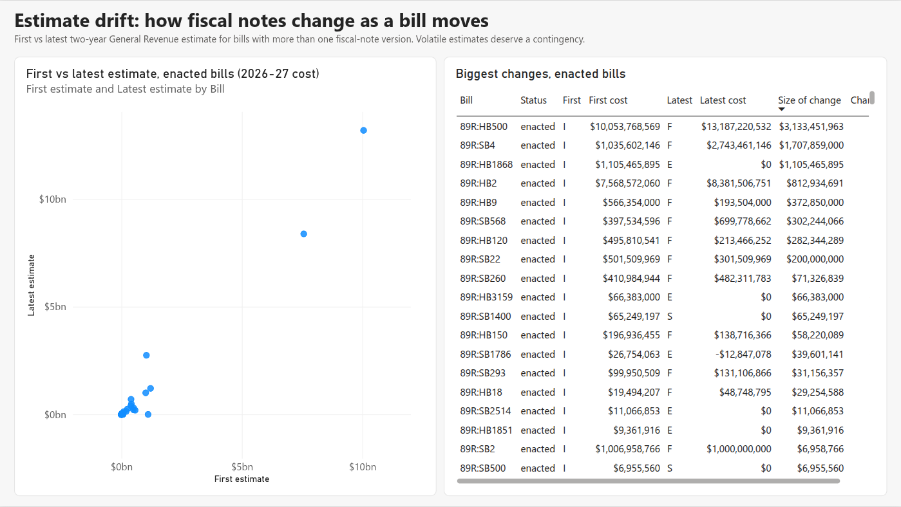

Enacted bills, sorted by the size of the change. HB 500 and HB 2 are the two dots far out on the right; SB 4 is the one
that rose to $2.7bn.

### 5. Watchlist (2027)
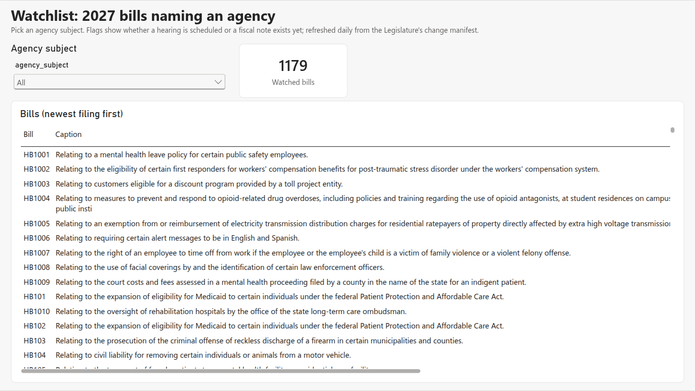

### 6. Trust & review
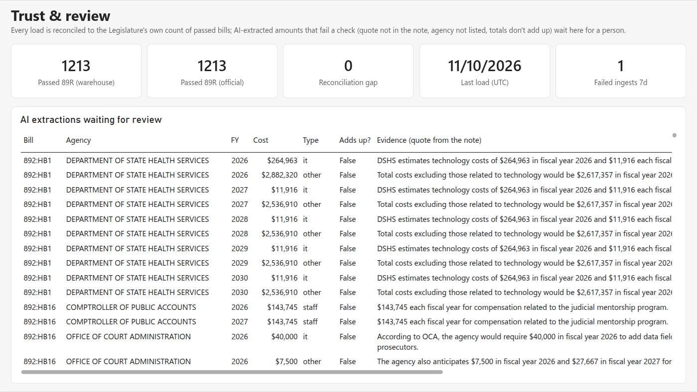

Warehouse 1,213 = official 1,213. "Failed ingests 7d = 1" is the manifest run at 1:31 AM CT on 2026-11-10: after midnight
the Legislature's change list is empty and the XML copy failed (`UserErrorTypeInSchemaTableNotSupported`). That led to
the size check and the 11:30 PM schedule (RUNBOOK). It ages out of the 7-day window on 2026-11-17.

**Report fixes made while capturing these (2026-11-10):** the cost card read "$0.0bnM" (double scaling); KPIs counted
an appropriations bill (115 bills / 842 jobs → 114 / 808); agency bars were sorted A-Z; the drift scatter showed one
summed dot instead of one per bill; tables had totals rows that added up percentages; the calendar listed undated bills
first. All fixed in `src/txfr/powerbi.py`.

**Still rough:** caption columns are wide, so the cost columns in *Largest enacted bills* sit behind a horizontal scroll;
watchlist bills all share the same filing day so far, so "newest first" looks like bill order.

## The findings, as figures

These come from the same SQL views as the report (`tools/make_figures.py`).

### Session pulse: most bills never leave committee

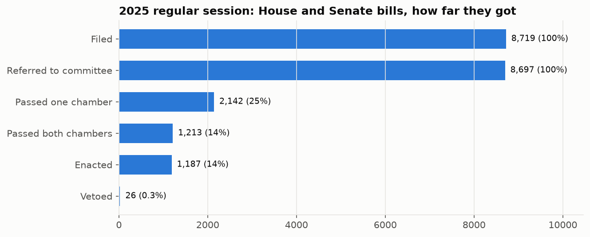

8,719 House and Senate bills filed, **1,213 passed both chambers (equal to the Legislature's own count)**, 1,187 enacted, 26 vetoed.

### Fiscal exposure: who carries the new cost

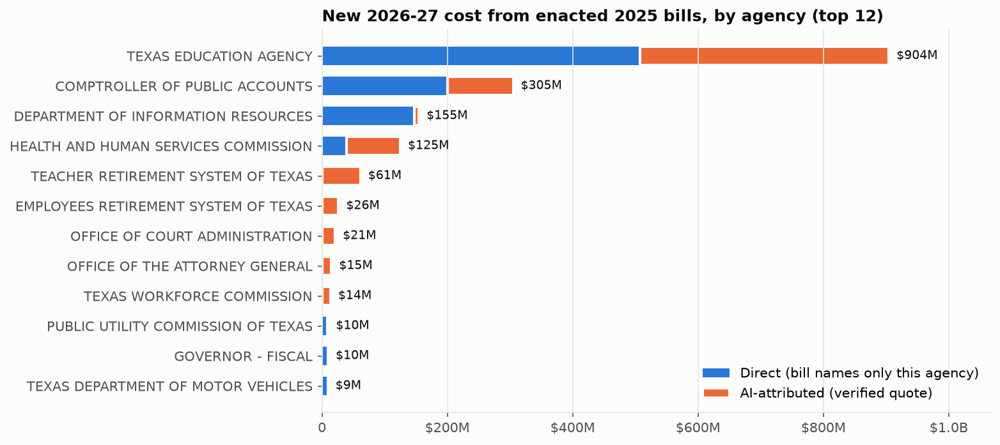

$16.8B of new 2026-27 spending across 114 enacted bills. HB 2 (school finance) is half of it. Appropriations bills
(HB 500, $13.2B) are excluded here and counted separately.

### Readiness: new cost relative to agency size

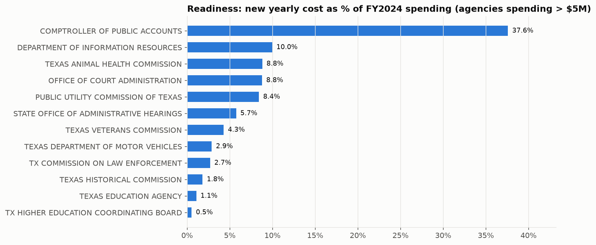

DIR (~10% of yearly spend, 139 positions), Office of Court Administration (~9%) and PUC (~8%) stand out. The
Comptroller's 38% is mostly tax bills where it is the only agency listed, so those are flagged, not reassigned.

### Estimate drift

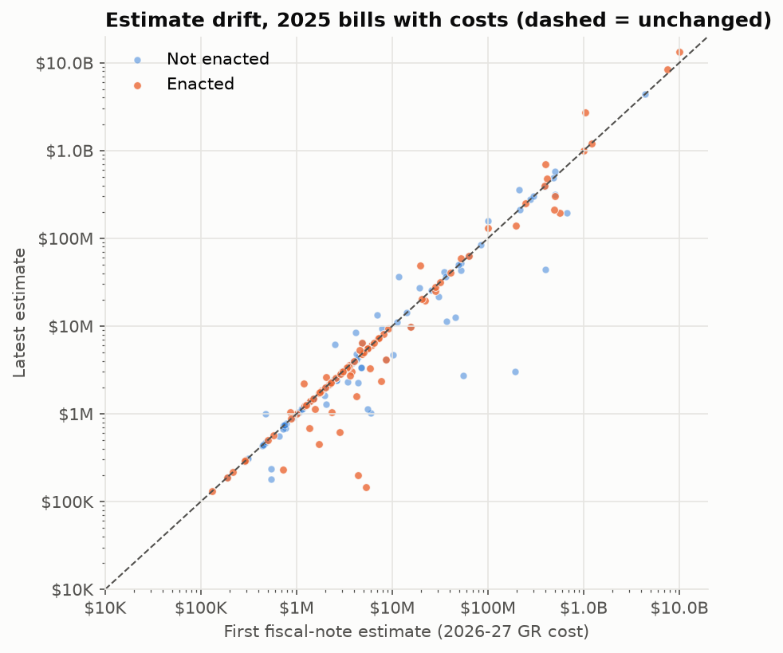

49 enacted bills moved more than 25% between first and last fiscal note. SB 4 (homestead exemption): $1.0B → $2.7B.

### Watchlist: 2027 filing pace

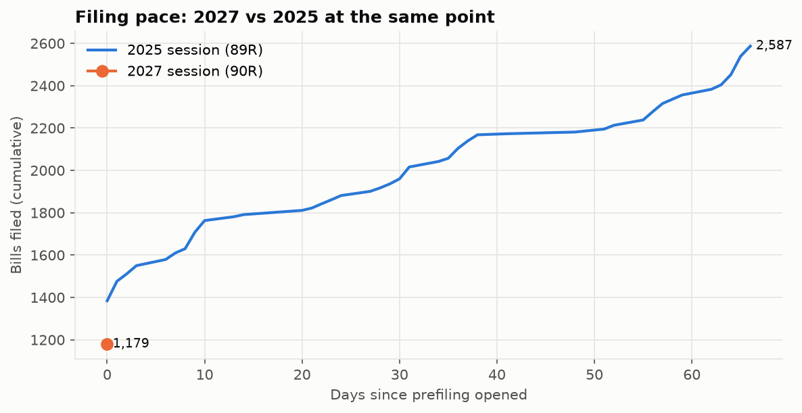

Prefiling for the 90th Legislature opened 2026-11-09. Now that the daily trigger is on, this chart updates every night.

## What to check first

1. Open the report and look at **Trust & review**: 529 AI-extracted rows failed a check. That count is what the 48% verified figure rests on.
2. [DRILLS.md](DRILLS.md): 37 practice questions answered from this build.
3. [REVIEW.md](REVIEW.md): the textbook-library review and the two fixes it led to.
4. Wednesday morning: the first scheduled run's result is in `ctl.ingest_run` / `ctl.load_run` (`tools/run_sql.py`).
   Failed runs also send an email alert.

## Next (not done)

- Refresh the Power BI push dataset from the pipeline (service principal + `pl_daily` final step) so the report updates without the personal login.
- Retry the Foundry → AI Search connection; it returned HTTP 500 on every attempt, so the agent searches client-side for now.
- Rerun `tools/cost_report.py` for billed cost once Cost Management stops rate-limiting.
